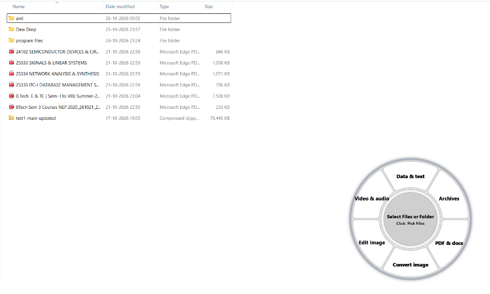
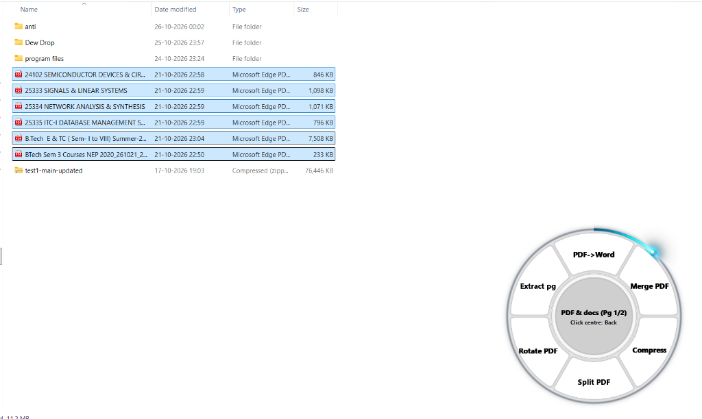
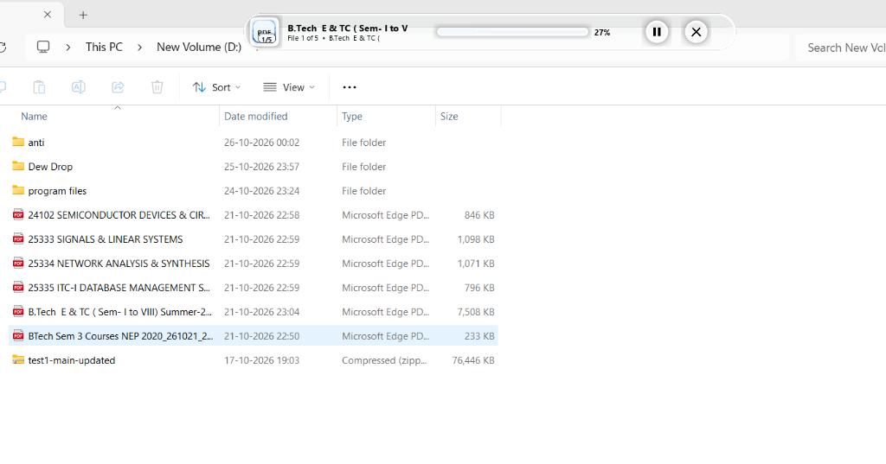

# Dew Drop

An on-demand, offline desktop tool ring for Windows with optical liquid-glass aesthetics.



## Overview

Dew Drop provides 50 offline utilities through an interactive 6-segment radial interface. It runs strictly on demand: nothing installs as a background service or startup item. Pressing the activation hotkey opens the ring at your cursor; if left idle, it automatically exits after 120 seconds to free all system resources.



## Key Characteristics

- **Zero Background Footprint**: No startup entries in the registry, no resident services, and no background daemon. The app launches on hotkey press (`CTRL+ALT+Z` by default) and exits cleanly when idle for 120 seconds.
- **Offline Operation**: The application makes zero network calls while running (no sockets, no telemetry, no remote requests). Note that `Install.bat` uses `pip` during initial setup to download required Python libraries from PyPI.
- **Non-Destructive**: Original files are never modified or overwritten. Output files are placed in a dedicated `Dew Drop` subfolder alongside the originals (or in `~/Documents/Dew Drop` if the input directory is read-only).
- **Defensive Hardening & Resource Caps**: File operations enforce strict safety limits against path traversal (Zip-Slip), decompression bombs, macro execution, and malicious PDF active content. On Windows, worker processes run under a 3 GiB Job Object memory limit to mitigate runaway allocations and memory bombs (note: this is a resource cap, not a security sandbox; it does not restrict filesystem or syscall access).



## 50 Offline Tools Across 6 Real Categories

The catalogue below reflects the exact 50 tools defined in `dewdrop/dewdrop_core.py`:

### 1. Convert Image (5 tools)
- **PNG** (`img_to_png`): Convert to PNG format with optional max width and rotation.
- **JPEG** (`img_to_jpeg`): Convert to JPEG format with customizable quality (1–100).
- **WEBP** (`img_to_webp`): Convert to WebP format with quality control (1–100).
- **GIF** (`img_to_gif`): Convert to animated/static GIF with width and rotation options.
- **ICO** (`img_to_ico`): Square-padded Windows icon generation (16px to 256px; canvas is capped at 256×256 pixels to prevent memory exhaustion).

### 2. Edit Image (7 tools)
- **Compress** (`img_compress`): Quality adjustment or target size in KB.
- **Resize** (`img_resize`): Proportional percentage scaling or bounding box fitting.
- **Crop shape** (`img_crop`): Aspect ratio cropping (1:1, 16:9, 4:3, 9:16) or custom interactive box.
- **Rotate/Flip** (`img_rotate_flip`): 90°/180°/270° rotation and horizontal/vertical mirroring.
- **Effects** (`img_effects`): Visual filter presets (Grayscale, Sepia, Invert, Blur, Sharpen, Brightness/Contrast).
- **Watermark** (`img_watermark`): Stamp customizable text overlay in any corner.
- **Clean EXIF** (`img_strip_meta`): Instantly strip all EXIF metadata and GPS tags.

### 3. PDF & Docs (13 tools)
- **Images->PDF** (`pdf_from_images`): Combine multiple images into a single PDF document.
- **Merge PDF** (`pdf_merge`): Concatenate multiple PDF files in sequential order.
- **Split PDF** (`pdf_split`): Explode a PDF document into individual single-page files.
- **Extract pg** (`pdf_extract_pages`): Extract a specific page or comma/hyphen page range (e.g. `1-3,5`).
- **Delete pg** (`pdf_delete_pages`): Remove specified pages from a PDF.
- **Reverse** (`pdf_reverse`): Reverse page ordering from last to first.
- **Rotate PDF** (`pdf_rotate`): Rotate pages by 90°, 180°, or 270°.
- **Compress** (`pdf_compress`): Re-compress content streams and optimize image assets.
- **PDF->Text** (`pdf_to_text`): Extract plain text stream from PDF pages.
- **PDF->Pics** (`pdf_extract_images`): Extract embedded raster images as discrete image files.
- **Clean PDF** (`pdf_strip_meta`): Remove metadata, embedded scripts, and interactive actions.
- **PDF->Word** (`pdf_to_word`): Convert PDF layout and text into an editable Word document (`.docx`).
- **Word->PDF** (`word_to_pdf`): Render modern Word document (`.docx`) into a PDF file (supports up to 63 columns per table, consistent with the WordprocessingML specification).

### 4. Video & Audio (12 tools, require FFmpeg)
- **MP4** (`media_to_mp4`): Transcode video to H.264 video with AAC audio.
- **WEBM** (`media_to_webm`): Transcode video to VP9 video with Opus audio.
- **MP3** (`media_to_mp3`): Extract or convert audio track to MP3.
- **M4A** (`media_to_m4a`): Extract or convert audio track to AAC (`.m4a`).
- **WAV** (`media_to_wav`): Convert audio to uncompressed PCM WAV.
- **FLAC** (`media_to_flac`): Convert audio to lossless FLAC format.
- **Shrink Vid** (`video_compress`): Multi-tier CRF video compression with optional maximum height.
- **Shrink Aud** (`audio_compress`): Compress audio bitrate (64 kbps to 320 kbps).
- **Trim** (`media_trim`): Cut media clip by specifying start and end timestamps.
- **Video->GIF** (`video_to_gif`): Convert short video clips into animated GIF files.
- **Mute Video** (`video_mute`): Strip audio stream without re-encoding video frames.
- **Frame->PNG** (`video_frame_png`): Capture an exact high-resolution frame at timestamp as PNG.

### 5. Archives (4 tools)
- **Make ZIP** (`archive_zip`): Package staged files into a compressed `.zip` archive.
- **TAR.GZ** (`archive_targz`): Package staged files into a `.tar.gz` archive.
- **GZIP** (`archive_gzip`): Compress a single file using `.gz` compression.
- **Extract** (`archive_extract`): Safely extract `.zip`, `.tar.gz`, `.tgz`, or `.gz` archives into a subfolder.

### 6. Data & Text (9 tools)
- **JSON Pretty** (`json_pretty`): Reformat and indent JSON with 2 spaces.
- **JSON Min** (`json_minify`): Strip whitespace to produce compact, single-line JSON.
- **JSON->CSV** (`json_to_csv`): Convert a JSON list of objects into tabular CSV format.
- **CSV->JSON** (`csv_to_json`): Convert tabular CSV rows into a structured JSON array.
- **To UTF-8** (`text_utf8`): Normalize text encoding to standard UTF-8 with LF line endings.
- **CRLF Lines** (`text_crlf`): Convert newline characters to Windows CRLF (`\r\n`).
- **SRT->VTT** (`srt_to_vtt`): Convert SubRip subtitle files (`.srt`) to WebVTT format (`.vtt`).
- **VTT->SRT** (`vtt_to_srt`): Convert WebVTT subtitles (`.vtt`) back to SubRip (`.srt`).
- **Checksums** (`checksums_all`): Compute and export MD5, SHA-1, SHA-256, and SHA-512 hashes.

## System Requirements

- **Operating System**: Windows 10 or Windows 11 (64-bit)
- **Python**: 3.11 or newer (when installing or running from source)
- **FFmpeg**: Required only for Video & Audio utilities. Dew Drop checks the following locations in order:
  1. `<install_dir>\ffmpeg.exe`
  2. `<install_dir>\assets\ffmpeg.exe`
  3. Python environment directory (`<python_dir>\ffmpeg.exe`)
  4. System `PATH` (`shutil.which("ffmpeg")`)
  5. Package manager paths (`%ProgramFiles%\ffmpeg\bin`, Chocolatey, Scoop, WinGet)

## Installation

### Option 1: Standalone Installer

1. Download `Dewdrop-Setup.exe` from the latest release.
2. Because the binary is self-built and unsigned, Windows SmartScreen may display a warning dialog. Click **More info**, then click **Run anyway**.
3. Choose your desired install location (defaults to `%LOCALAPPDATA%\Programs\DewDrop`) and global activation hotkey (default: `CTRL+ALT+Z`).

### Option 2: Install from Source

1. Clone or download this repository.
2. Ensure [Python 3.11+](https://www.python.org/downloads/) is installed and added to your `PATH`.
3. Double-click `Install.bat` (or run it from a command prompt):
   ```cmd
   Install.bat
   ```
4. `Install.bat` verifies Python 3.11+, installs dependencies from `dewdrop/requirements.txt` via `pip`, deploys files to `%LOCALAPPDATA%\Programs\DewDrop`, and creates Start Menu and Desktop shortcuts with the specified hotkey.

## Quick Launch Without Installing

To run directly from source without installing to your user profile:

```cmd
Run-Now.bat
```

Or execute directly with Python:

```cmd
python dewdrop/dewdrop_runtime.py
```

## Building the Installer

To build the standalone single-file installer (`Dewdrop-Setup.exe`):

```cmd
python dewdrop/build_installer.py
```

This compiles `dewdrop.exe` with PyInstaller, compresses it into the installer payload, and generates the final setup executable.

## Uninstallation

To remove Dew Drop:
- Run `Uninstall.bat` from the repository or from `%LOCALAPPDATA%\Programs\DewDrop`.
- The uninstaller stops running Dew Drop processes, deletes Desktop and Start Menu shortcuts, deletes `%LOCALAPPDATA%\Programs\DewDrop`, and prompts whether to delete user preferences from `%APPDATA%\DewDrop`.

## Security & Verification

Defensive validation rules implemented across core operations:
- **Archive Extraction Safety**: Archive extraction rejects absolute paths, drive/ADS colons, `..` traversal sequences, symlink/device entries, and reserved Windows device names (`CON`, `NUL`, `AUX`, `COM1-9`, `LPT1-9`). Extraction is capped at 512 MiB total and 2,000 files.
- **Image Bomb Limits**: Image dimensions are checked before decompression; inputs exceeding 40 megapixels (`MAX_IMAGE_PIXELS = 40_000_000`) are rejected.
- **PDF Sanitization**: An allow-list approach is enforced: only verified `http://`, `https://`, and `mailto:` link annotations without `/Next` action chains are preserved. Embedded scripts (`/JavaScript`, `/JS`), automatic triggers (`/Launch`, `/OpenAction`, `/AA`), interactive form fields, outlines actions, document metadata, and embedded files are removed.
- **Office Macro Rejection**: Word `.docx` documents containing `vbaProject.bin` or macro streams are rejected before processing.
- **FFmpeg Protocol Whitelist**: Passes `-protocol_whitelist "file,pipe" -nostdin` to FFmpeg to block remote network calls or unauthorized protocol redirection.
- **Filename & Path Sanitization**: Neutralizes leading hyphens (`-`), Windows reserved device names, NTFS ADS colons (`:`), and trailing whitespace/dots.

To run the verification test suite:

```cmd
python dewdrop/tests/self_test.py
```

## Known Limitations

- **Simplified Word->PDF Rendering**: Word-to-PDF conversion uses ReportLab Platypus to render document text, tables, and images in sequence. Complex floating shapes, WordArt, and proprietary pagination features are not preserved.
- **PDF Form Fields & Metadata**: Sanitizing PDF documents strips interactive form fields (`/AcroForm`, `/XFA`) and document metadata.
- **Text-Only PDF Extraction**: PDF-to-Word conversion extracts native text streams and layouts. Scanned image-only PDFs require OCR preprocessing.
- **Word Document Formats**: Word-to-PDF conversion processes modern `.docx` format (OpenXML). Older binary `.doc` format is not supported.
- **Word Tables & Columns**: Word-to-PDF supports tables up to 63 columns (the OpenXML standard maximum) and documents up to 5,000 table rows or 200,000 total cells to prevent memory exhaustion.
- **ICO Canvas Limit**: Windows ICO icons are capped at a maximum canvas size of 256×256 pixels.
- **Resource Limits**: Individual batch operations enforce safety ceilings: 40 MP per image, 200 pages per PDF document, and 512 MB maximum output size.
- **FFmpeg Dependency**: Audio and video operations require `ffmpeg.exe` to be installed and accessible on your system (not bundled).
- **Unsigned Installer**: Because installer binaries are self-compiled open-source releases without a paid code-signing certificate, Windows SmartScreen may show an "Unknown Publisher" prompt upon first launch.

## License

This project is licensed under the [MIT License](LICENSE).
